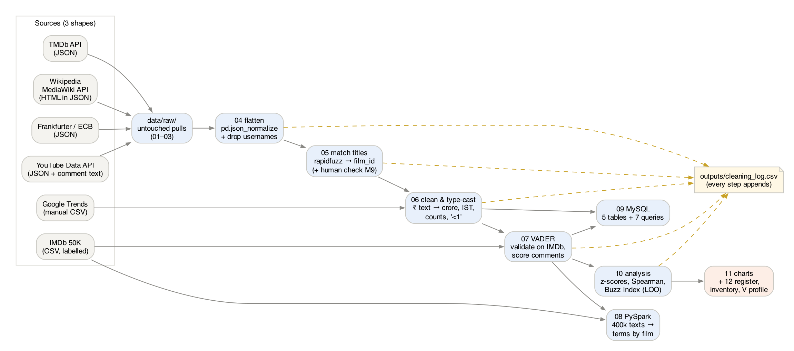
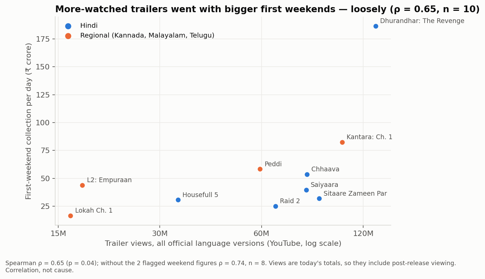
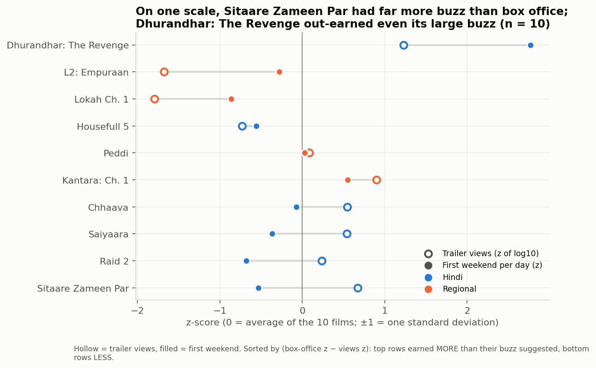
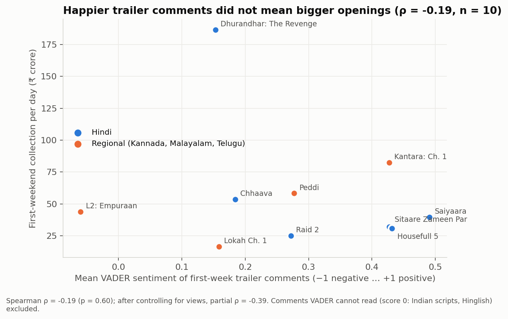
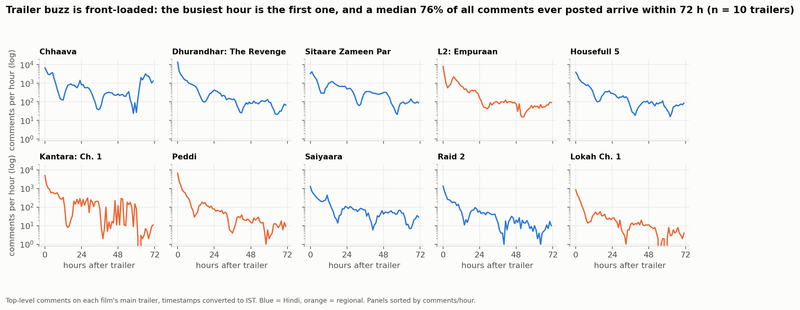
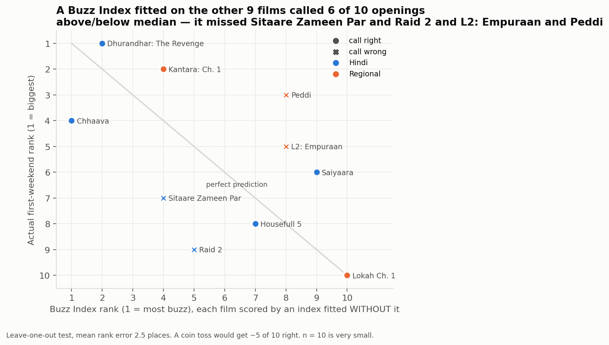

<!-- GENERATED FILE: edit report/report_template.md, then run `make report`. Every number below is filled in by src/14_build_report.py from files in outputs/. -->

# a. Executive summary

Across 10 Hindi and regional films released in 2025–26, films whose trailers were watched more had bigger first weekends, but the link is loose and does not prove that one causes the other. How *positive* the trailer comments sounded told us nothing extra: the biggest opener had some of the least positive comments, and a buzz score built from all our online signals called only 6 of 10 films correctly. For next Friday, use trailer reach as an early hint when planning shows, but make the add-or-cut screens decision on Friday's actual collections, not on online buzz.

# b. The question and why it matters

**Question.** *Did trailer-week YouTube engagement predict first-weekend collections for 10 Hindi and regional films released in 2025–26, and does audience sentiment add anything beyond raw views?*

**Decision it serves.** Within 72 hours of each Friday release, the Head of Distribution decides whether to **add screens, cut screens, or spend more on promotion**. Today that call rests on gut feel, a few trade tweets and the Friday-night number. Trailer buzz is available *weeks earlier*. If it predicted the first weekend, show bookings could be planned before release. If it does not, the desk should stop reading trailer hype as a signal.

**Films (n = 10, 4 regional):** Chhaava, Saiyaara, Sitaare Zameen Par, Housefull 5, Raid 2 and Dhurandhar: The Revenge (Hindi), plus Kantara: Chapter 1 (Kannada), Lokah Chapter 1: Chandra and L2: Empuraan (Malayalam) and Peddi (Telugu). They were chosen from 18 candidates because each has a stated first-weekend figure on Wikipedia and an official trailer with open comments. The eight dropped films, and the reason for each, are listed in `data/manual/film_list_proposed.csv`.

**Outcome measure.** First-weekend worldwide gross divided by the number of weekend days (₹ crore per day). Six films opened on a Thursday and had 4-day weekends, so raw totals would favour them.

# c. Data inventory and V profile

We used **6 sources in 3 shapes**:

- **Structured:** Wikipedia box-office infobox and text (MediaWiki API, HTML inside JSON) and Google Trends (CSV).
- **Semi-structured:** the YouTube Data API v3, TMDb and Frankfurter/ECB, all JSON.
- **Unstructured:** 350,426 YouTube trailer comments, plus the labelled IMDb 50K reviews as a practice corpus.

Every field is classified below.

| field                     | table             | example                  | measurement_type                                       | shape                     | source                           |
|:--------------------------|:------------------|:-------------------------|:-------------------------------------------------------|:--------------------------|:---------------------------------|
| film_id                   | all tables        | kantara_chapter_1        | nominal                                                | structured                | created in step 05               |
| title_clean               | films             | Kantara: Chapter 1       | nominal                                                | structured                | film list / Wikipedia            |
| language                  | films             | Kannada                  | nominal                                                | structured                | Wikipedia infobox                |
| genre                     | films             | Action, Drama, Fantasy   | nominal                                                | semi-structured           | TMDb JSON                        |
| runtime_min               | films             | 169                      | discrete                                               | structured                | Wikipedia infobox                |
| release_date              | films             | 2025-10-02               | interval (date)                                        | structured                | Wikipedia infobox                |
| budget_cr                 | films             | 110.0                    | continuous                                             | structured                | Wikipedia infobox                |
| tmdb_id                   | films             | 1083637                  | nominal (an id, not a quantity)                        | semi-structured           | TMDb JSON                        |
| first_weekend_ww          | box_office        | 330.0                    | continuous                                             | unstructured → structured | Wikipedia article text           |
| first_weekend_per_day     | box_office        | 82.5                     | continuous                                             | derived                   | step 06                          |
| lifetime_gross_ww         | box_office        | 851.0                    | continuous                                             | structured                | Wikipedia infobox + yearly table |
| weekend_days              | film list         | 4                        | discrete                                               | structured                | release weekday                  |
| scope_flag                | box_office.note   | domestic_only            | nominal                                                | structured                | step 06                          |
| youtube_video_id          | trailers          | TMQUFhWm8C0              | nominal                                                | semi-structured           | YouTube JSON                     |
| is_main_trailer           | trailers          | 1                        | nominal (binary)                                       | semi-structured           | step 03                          |
| publish_ts                | trailers          | 2025-09-22 12:44:00 IST  | interval (timestamp)                                   | semi-structured           | YouTube JSON                     |
| views                     | trailers          | 23925371                 | discrete (count)                                       | semi-structured           | YouTube JSON                     |
| likes                     | trailers          | 512345                   | discrete (count)                                       | semi-structured           | YouTube JSON                     |
| comment_count             | trailers          | 20869                    | discrete (count)                                       | semi-structured           | YouTube JSON                     |
| comment text (text_clean) | comments          | Goosebumps!! 🔥          | unstructured                                           | unstructured              | YouTube JSON → text              |
| published_ts              | comments          | 2025-01-22 17:20:11 IST  | interval (timestamp)                                   | semi-structured           | YouTube JSON                     |
| length                    | comments          | 15                       | discrete                                               | derived                   | step 06                          |
| vader_compound            | comments          | 0.6369                   | continuous (−1 to +1)                                  | derived                   | step 07                          |
| vader label (pos/neg)     | validation        | positive                 | nominal                                                | derived                   | step 07                          |
| interest                  | trends_daily      | 100                      | ordinal-like relative index (0–100, scaled per export) | structured                | Google Trends CSV                |
| date                      | trends_daily      | 2025-10-03               | interval (date)                                        | structured                | Google Trends CSV                |
| IMDb review text          | imdb_50k          | One of the best films... | unstructured                                           | unstructured              | IMDb 50K CSV                     |
| IMDb sentiment label      | imdb_50k          | positive                 | nominal (binary)                                       | structured                | IMDb 50K CSV                     |
| match score               | film_matches      | 79.1                     | continuous (0–100)                                     | derived                   | step 05                          |
| box-office trade rank     | wiki yearly table | 2                        | ordinal                                                | structured                | Wikipedia yearly list            |

## V profile (one page)

| v        | measure                                                       | value      | unit_or_detail                                                                                                 |
|:---------|:--------------------------------------------------------------|:-----------|:---------------------------------------------------------------------------------------------------------------|
| Volume   | YouTube raw JSON (stats + comment pages)                      | 374        | MB                                                                                                             |
| Volume   | YouTube comment pages downloaded                              | 3,552      | files                                                                                                          |
| Volume   | Trailer comments after cleaning                               | 350,426    | rows                                                                                                           |
| Volume   | Wikipedia raw JSON                                            | 2.6        | MB                                                                                                             |
| Volume   | TMDb raw JSON                                                 | 0.4        | MB                                                                                                             |
| Volume   | Google Trends CSVs                                            | 0.006      | MB                                                                                                             |
| Volume   | Google Trends daily rows                                      | 375        | rows                                                                                                           |
| Volume   | IMDb 50K corpus                                               | 50,000     | rows                                                                                                           |
| Volume   | IMDb 50K corpus size                                          | 66.2       | MB                                                                                                             |
| Volume   | Spark job input (comments + IMDb, tagged by source)           | 400,008    | rows (1c union in spark_stage_counts.csv)                                                                      |
| Volume   | Spark job word rows after explode                             | 14,324,736 | rows (4a in spark_stage_counts.csv)                                                                            |
| Variety  | Formats                                                       | 4          | HTML-in-JSON (Wikipedia), JSON (YouTube, TMDb, Frankfurter), CSV (Trends, IMDb), free text (comments, reviews) |
| Variety  | Sources                                                       | 6          | Wikipedia, TMDb, YouTube, Google Trends, Frankfurter, IMDb 50K                                                 |
| Variety  | Title strings from 5 sources tied to the 10 film_ids          | 56         | strings (data/clean/film_matches.csv)                                                                          |
| Velocity | Median share of a trailer's comments posted in its first 72 h | 0.781      | share                                                                                                          |
| Velocity | Highest comments/hour in any single hour (first 72 h)         | 8,780      | comments/hour                                                                                                  |
| Velocity | Mean comments/hour over first 72 h (median film)              | 316        | comments/hour                                                                                                  |
| Velocity | Google Trends peak, days after release (median)               | 0          | days                                                                                                           |
| Velocity | Google Trends: days from peak until interest halves (median)  | 5          | days                                                                                                           |

**Which V dominated: Variety.** The same film arrived as "Saiyaara (film)", "Kantara - A Legend: Chapter 1" and "RAID 2 (TRAILER): Ajay D | Riteish D | …". Money arrived as "₹797.34–809 crore[b]", "est. ₹30−40 crore" and "over $80 million". Tying 56 title strings to 10 film keys, and turning six kinds of money text into one number, took most of the build.

**Velocity came second, and it surprised us.** Trailer buzz is extremely front-loaded:

- For the median trailer, 78% of all the comments it has *ever* received arrived in its first 72 hours.
- The busiest single hour carried 8,780 comments.
- Search interest peaks on release day and halves within about 5 days.

**Volume was moderate.** We collected 374 MB of raw YouTube JSON (3,552 API pages), and the Spark job processed 400,008 texts.

**How the Vs changed our tools:**

- *Variety* pushed us to fuzzy matching (rapidfuzz), a shared `film_id`, and a relational model in MySQL.
- *Velocity* made us download **every** comment, not a 5,000-per-film cap. YouTube returns comments newest first, so a cap would have contained no trailer-week comments at all.
- *Volume*, once comments were split into 14,324,736 word rows, is where PySpark earned its place.

# d. Pipeline: how data moves from source to chart

{width=100%}

| Stage | Script | What it does |
|---|---|---|
| Collect | `01`–`03` | MediaWiki API (`action=parse`), TMDb `/search` + `/movie`, YouTube `videos`/`search`/`commentThreads`. Raw JSON is saved untouched. YouTube quota is hard-capped at 10,000 units/day. |
| Flatten | `04` | `pd.json_normalize` turns nested JSON into tables. Author names, channel IDs and profile URLs are dropped here (example in Appendix C). |
| Match | `05` | Normalise titles, then score them with rapidfuzz: ≥ 95 accept, 70–94 a person confirms, < 70 reject. |
| Clean | `06` | ₹ text → crore, ranges → midpoint, USD → ₹ at the release-date ECB rate, UTC → IST, text counts → integers, Trends "<1" → 0.5. |
| Sentiment | `07` | VADER is validated on the labelled IMDb reviews, then scores every comment. |
| Big data | `08` | PySpark, local mode: clean, measure length, count terms, aggregate by film and source. |
| Model | `09` | MySQL: 5 tables with primary and foreign keys, and 7 queries (Appendix A). |
| Analyse | `10`–`12` | z-scores, Spearman ρ, a leave-one-out Buzz Index, a bot-burst check, charts, and the evidence tables. |

`make all` reruns everything from the raw data to the charts.

# e. Cleaning log

The pipeline logged **32 decisions**, each with the problem found, rows affected, action taken and why. Every script appends its own rows with the counts it measured. The full table is in **Appendix E** (moved there because of its length).

**The five decisions that mattered most:**

1. **Where the trailer clock starts.** Raid 2 had 16,245 comments posted up to 20.7 hours *before* the trailer's official publish time, because the video was viewable early. We start every trailer window at the earlier of the publish time and the first comment. This single fix moved the comments-vs-weekend correlation from 0.56 to 0.37. We report the corrected, weaker number.
2. **Which number is "the first weekend".** Wikipedia gives opening figures as free text in mixed forms: day or weekend, worldwide or India-only, ranges, and USD. We saved all 38 candidate sentences and chose one phrase per film. The script then checks that the phrase appears **word for word** in the downloaded page, so a figure cannot be invented. Ranges became midpoints. Dhurandhar: The Revenge's "$80 million" was converted at the ECB rate on its release date.
3. **3-day vs 4-day weekends.** Six films opened on a Thursday. We divide by the number of days. Without that, those six would look about a third bigger.
4. **Film-name matching.** 56 title strings were matched to 10 IDs. Two scores (79.1 and 90.9) were confirmed by a person. One was **rejected**: "Dhurandhar", the 2025 prequel. A looser scorer would have joined it to the sequel and imported the wrong ₹1,350-crore gross.
5. **Comments VADER cannot read.** 9% of comments are written in Indian scripts and 29% score exactly 0, mostly Hinglish, names or emojis. We kept them, because they count for velocity, and excluded zero scores from the sentiment averages.

**Missing values, decided one by one:**

- **Budgets.** Kantara has no budget published, and Dhurandhar: The Revenge's is "combined with part 1". Both are NULL; we kept the films and did not invent a split.
- **Two weekend figures are not clearly worldwide** (Housefull 5 and Sitaare Zameen Par). We kept and flagged them, and tested results without them.
- **Comments.** 4,161 empty comments were dropped. 5 duplicate IDs were dropped.
- **Trends.** No days were missing, so nothing was filled.

# f. Findings

{width=95%}

**Finding 1, combining two sources (YouTube and Wikipedia).** More-watched trailers went with bigger first weekends: Spearman ρ = 0.65 (p = 0.04, n = 10). Without the two flagged weekend figures it is ρ = 0.74 (n = 8). *How sure are we?* Only moderately. Ten films is a tiny sample. View counts are **today's** totals, so a hit film's trailer keeps gaining views after release, which may inflate the link. And star power, screen count, holiday dates and franchise status all push views and collections up together.

{width=90%}

**Finding 2, normalised (z-scores).** Putting views and collections on one scale shows *where* buzz misled. Sitaare Zameen Par, Raid 2 and Saiyaara had much more trailer reach than first-weekend money. Dhurandhar: The Revenge and the two Malayalam films earned more than their trailer reach suggested. Sitaare's most common comment terms were "movie, khan, boycott, copy, champions, amir": **a lot of its buzz was a boycott-and-copy argument, not intent to buy tickets**. That is one film, so treat it as a hypothesis.

{width=95%}

**Finding 3: sentiment adds nothing.** Mean comment sentiment did not track the first weekend: ρ = -0.19 (p = 0.60). After controlling for views it is, if anything, negative (partial ρ = -0.39). On the labelled IMDb reviews VADER scored only 0.700 accuracy (macro-F1 0.692). It leans positive, calling 11,411 negative reviews positive, so its trailer scores are noisy too. Hindi trailers drew more positive comments than regional ones (0.31 vs 0.16), partly because VADER reads English and Hinglish better than Indian scripts.

{width=100%}

**Finding 4: velocity.** For the median trailer, 78% of all its comments ever arrived within 72 hours, and the busiest hour is the first. First-week comment counts were only weakly related to the first weekend (ρ = 0.37, p = 0.29).

{width=80%}

**Finding 5: the Buzz Index (beyond the minimum).** We combined z-scored views, like ratio, comment volume, comment velocity and sentiment, weighting each by its rank correlation with the outcome. We then tested it honestly: each film was scored by an index built from the *other nine*. It called 6 of 10 openings correctly as above or below the median (mean rank error 2.5 places), against about 5 of 10 for a coin toss. It missed Sitaare Zameen Par, Raid 2, L2 Empuraan, Peddi. **It is not reliable enough to act on alone.**

**Paid or bot buzz: Raid 2's early comments look seeded.** Raid 2 received 16,245 comments *before* its trailer's official publish time. **88.6%** of them repeat text posted five or more times ("Can't wait", "So excited", "Trailer abhi tak nahi aaya? The wait is killing me!"). After publication, comments repeat at a rate of 18%–51%, whatever the film. Raid 2 also has 14.3% of its longer comments in same-hour copy-paste bursts, against at most 1.8% for every other film. We cannot prove who posted them, so we kept and flagged them. But they inflate Raid 2's comment-based buzz, and that fits the Buzz Index ranking it 5th when it actually opened 9th. Other films' bursts are mostly fan chants ("छत्रपति संभाजी महाराज की जय") and meme lines.

# g. Recommendation for next Friday

1. **Before release, sort, don't forecast.** Rank the new film's total trailer views (all language versions) against these 10 films:
   - **Top three:** pre-arrange *optional* extra shows with exhibitors.
   - **Bottom three:** do not add screens on hype.
   - Everything in between gives no signal.

   This is the strongest relationship we found (ρ = 0.65). It is still loose.
2. **Ignore whether the comments sound positive.** It added nothing (ρ = -0.19). Instead, **check the buzz for two warning signs:**
   - controversy words in the top comment terms, such as "boycott" and "copy" (Sitaare Zameen Par)
   - large blocks of copy-paste comments, especially before the trailer is officially out (Raid 2)

   In both cases, discount the buzz.
3. **Make the actual add/cut call on Friday's collections**, with trailer reach only as a tie-breaker. Our best buzz score called 6 of 10, not enough to move screens on its own.
4. **Conditions.** This is evidence from 10 films and not causal, and it is weaker for regional releases (4 films). Re-check the rule after every new release by adding it to the sample. `make all` does this in one command.

# h. Limitations and bias

- **Sample size.** n = 10 (4 regional). One correction to one film changed a correlation from 0.56 to 0.37. No result here is statistically robust.
- **Confounders.** Star power, screen count (not published consistently, so not used), holiday release, franchise status, budget and marketing spend, and Hindi vs regional market size.
- **Views are today's counts.** Trailer-week view counts cannot be fetched after the fact, so views include post-release viewing. That is a reverse-causation risk.
- **Who writes YouTube comments.** They come from younger, online, English/Hinglish-heavy fans, not ticket buyers in general. Regional audiences may comment on other platforms.
- **Paid promotion and bots.** We found one likely case: Raid 2's pre-publish comments are 88.6% copy-paste. We kept them, so its comment counts are probably inflated. Our checks cannot see paid *views*, or coordinated accounts that vary their wording.
- **Regional vs Hindi coverage.** Only 4 regional films, no Tamil film (Coolie had no weekend figure), and Sitaare's Tamil and Telugu trailers came out weeks later, outside our 3-day version window.
- **Box-office reliability.** Wikipedia figures mix producer-reported and trade estimates. They come as ranges and "est." values, with one in USD and one India-only. We used midpoints and flagged exceptions.
- **VADER's limits.** 0.700 accuracy on IMDb. It cannot read Indian scripts (9% of comments), and it misses Hinglish, sarcasm and many emojis. 29% of comments score 0.
- **Missing Reddit data.** API access needs approval, so Reddit was skipped. Discussion-forum audiences may differ again.

# i. Reflection

**How the question changed.** We began with "do trailer views predict opening weekends?" Three things changed it:

1. Wikipedia rarely states an "opening weekend" in a consistent form, which forced the per-day measure and the flagged exceptions.
2. We learned that YouTube only returns *today's* view counts. So "trailer-week engagement" had to be measured from comment **timestamps**, and views became a weaker, after-the-fact proxy.
3. Correcting Raid 2's trailer start time cut the comments correlation, and cut the Buzz Index from 8 to 6 correct calls. Looking into *why* Raid 2 had so many early comments then revealed the copy-paste pattern. The honest answer became "views are a loose hint, sentiment is noise, and comment counts can be gamed."

**With better data we would:**

- capture view counts *daily* from trailer launch (live tracking during release week)
- use screen counts and day-wise collections from a trade source with a licence
- use a multilingual sentiment model for Hindi, Telugu, Tamil, Kannada and Malayalam
- add Reddit and X once API access is approved
- extend the sample to 30+ releases, so the rule of thumb can be tested on films it has never seen

[[TODO-HUMAN: add one or two sentences, in your own words, on what surprised the team most]]

\newpage

# Appendix A — ER diagram, schema and SQL queries with outputs

{width=75%}

Rows loaded into MySQL:

| table        |   rows_loaded |
|:-------------|--------------:|
| films        |            10 |
| trailers     |            18 |
| box_office   |            37 |
| comments     |        350426 |
| trends_daily |           375 |

Schema (`sql/schema.sql`):

```sql
-- Release Day Radar — relational schema (MySQL 8)
-- One central table (films) and four tables that point to it with film_id.
-- Run order matters: films first, because the others have FOREIGN KEYs to it.

DROP TABLE IF EXISTS comments;
DROP TABLE IF EXISTS trends_daily;
DROP TABLE IF EXISTS box_office;
DROP TABLE IF EXISTS trailers;
DROP TABLE IF EXISTS films;

-- One row per film. film_id is our own canonical key (built in step 05),
-- because each source spells titles differently ("Kantara - A Legend: Chapter 1" on TMDb).
CREATE TABLE films (
    film_id       VARCHAR(40)  NOT NULL PRIMARY KEY,
    title_clean   VARCHAR(120) NOT NULL,
    language      VARCHAR(20)  NOT NULL,          -- nominal: Hindi / Kannada / Malayalam / Telugu
    genre         VARCHAR(120),                   -- nominal, comma-separated TMDb genres
    runtime_min   SMALLINT,                       -- discrete
    release_date  DATE         NOT NULL,
    budget_cr     DECIMAL(8,2),                   -- continuous, ₹ crore, NULL when not published
    tmdb_id       INT          UNIQUE
);

-- One row per trailer VIDEO. A film can have several (dubbed language versions).
CREATE TABLE trailers (
    trailer_id        INT          NOT NULL AUTO_INCREMENT PRIMARY KEY,
    film_id           VARCHAR(40)  NOT NULL,
    youtube_video_id  CHAR(11)     NOT NULL UNIQUE,
    is_main_trailer   BOOLEAN      NOT NULL,
    publish_ts        DATETIME     NOT NULL,      -- stored in IST
    views             BIGINT       NOT NULL,      -- discrete count
    likes             BIGINT,                     -- NULL if the channel hides likes
    comment_count     INT,
    FOREIGN KEY (film_id) REFERENCES films(film_id)
);

-- Long ("tidy") format: one row per film per metric, so new metrics need no new columns.
CREATE TABLE box_office (
    film_id    VARCHAR(40)  NOT NULL,
    metric     VARCHAR(40)  NOT NULL,             -- e.g. first_weekend_ww, first_weekend_per_day, lifetime_gross_ww
    value_cr   DECIMAL(10,2) NOT NULL,            -- ₹ crore
    source     VARCHAR(60)  NOT NULL,             -- which page/table it came from
    note       VARCHAR(200),                      -- e.g. "range midpoint", "domestic only", "converted from USD"
    PRIMARY KEY (film_id, metric, source),
    FOREIGN KEY (film_id) REFERENCES films(film_id)
);

-- Comments on each film's main trailer. NO usernames or channel ids (privacy rule).
CREATE TABLE comments (
    comment_id      VARCHAR(64)  NOT NULL PRIMARY KEY,
    film_id         VARCHAR(40)  NOT NULL,
    published_ts    DATETIME     NOT NULL,        -- IST
    text_clean      TEXT         NOT NULL,
    length          INT          NOT NULL,        -- characters, discrete
    vader_compound  DECIMAL(5,4),                 -- continuous, -1 to +1
    FOREIGN KEY (film_id) REFERENCES films(film_id),
    INDEX idx_comments_film_time (film_id, published_ts)
);

-- Google Trends: one row per film per day.
CREATE TABLE trends_daily (
    film_id   VARCHAR(40) NOT NULL,
    date      DATE        NOT NULL,
    interest  DECIMAL(5,1) NOT NULL,              -- 0–100, relative within each film's own export
    PRIMARY KEY (film_id, date),
    FOREIGN KEY (film_id) REFERENCES films(film_id)
);

```

# SQL queries and their outputs

Generated by `src/09_load_mysql.py` from `sql/queries.sql`.

## Q1. What is in the database? Row count of every table (evidence for "row counts per table").

```sql
SELECT 'films' AS table_name, COUNT(*) AS row_count FROM films
UNION ALL SELECT 'trailers', COUNT(*) FROM trailers
UNION ALL SELECT 'box_office', COUNT(*) FROM box_office
UNION ALL SELECT 'comments', COUNT(*) FROM comments
UNION ALL SELECT 'trends_daily', COUNT(*) FROM trends_daily
```

| table_name   |   row_count |
|:-------------|------------:|
| films        |          10 |
| trailers     |          18 |
| box_office   |          37 |
| comments     |      350426 |
| trends_daily |         375 |

## Q2. (JOIN + GROUP BY) For each film: total trailer views across all language versions, next to its first-weekend collection per day. This is the core comparison of our question.

```sql
SELECT f.film_id,
       f.language,
       COUNT(t.trailer_id)            AS trailer_versions,
       SUM(t.views)                   AS total_trailer_views,
       b.value_cr                     AS first_weekend_per_day_cr
FROM films f
JOIN trailers   t ON t.film_id = f.film_id
JOIN box_office b ON b.film_id = f.film_id AND b.metric = 'first_weekend_per_day'
GROUP BY f.film_id, f.language, b.value_cr
ORDER BY total_trailer_views DESC
```

| film_id                | language   |   trailer_versions |   total_trailer_views |   first_weekend_per_day_cr |
|:-----------------------|:-----------|-------------------:|----------------------:|---------------------------:|
| dhurandhar_the_revenge | Hindi      |                  5 |           1.30745e+08 |                     186.5  |
| kantara_chapter_1      | Kannada    |                  5 |           1.03992e+08 |                      82.5  |
| sitaare_zameen_par     | Hindi      |                  1 |           8.88989e+07 |                      31.83 |
| chhaava                | Hindi      |                  1 |           8.17284e+07 |                      53.5  |
| saiyaara               | Hindi      |                  1 |           8.13946e+07 |                      39.67 |
| raid_2                 | Hindi      |                  1 |           6.59729e+07 |                      25    |
| peddi                  | Telugu     |                  1 |           5.93947e+07 |                      58.25 |
| housefull_5            | Hindi      |                  1 |           3.39566e+07 |                      30.61 |
| l2_empuraan            | Malayalam  |                  1 |           1.76834e+07 |                      43.75 |
| lokah_chapter_1        | Malayalam  |                  1 |           1.63116e+07 |                      16.38 |

## Q3. (JOIN + GROUP BY) Velocity: how many comments arrived in the first 72 hours after the main trailer went live, and the average comments per hour in that window. "Went live" = the earlier of the API publish time and the first comment (Raid 2's trailer was commented on 20.7 h before its official publish time).

```sql
SELECT c.film_id,
       COUNT(*)                                   AS comments_first_72h,
       ROUND(COUNT(*) / 72, 1)                    AS comments_per_hour_72h
FROM comments c
JOIN (SELECT t.film_id, LEAST(t.publish_ts, MIN(c2.published_ts)) AS start_ts
      FROM trailers t
      JOIN comments c2 ON c2.film_id = t.film_id
      WHERE t.is_main_trailer = 1
      GROUP BY t.film_id, t.publish_ts) s ON s.film_id = c.film_id
WHERE c.published_ts >= s.start_ts
  AND c.published_ts <  s.start_ts + INTERVAL 72 HOUR
GROUP BY c.film_id
ORDER BY comments_first_72h DESC
```

| film_id                |   comments_first_72h |   comments_per_hour_72h |
|:-----------------------|---------------------:|------------------------:|
| chhaava                |                65719 |                   912.8 |
| dhurandhar_the_revenge |                41548 |                   577.1 |
| sitaare_zameen_par     |                38047 |                   528.4 |
| l2_empuraan            |                31536 |                   438   |
| housefull_5            |                23897 |                   331.9 |
| raid_2                 |                21632 |                   300.4 |
| kantara_chapter_1      |                18778 |                   260.8 |
| peddi                  |                16292 |                   226.3 |
| saiyaara               |                 8302 |                   115.3 |
| lokah_chapter_1        |                 3052 |                    42.4 |

## Q4. (JOIN + GROUP BY) Do Hindi and regional films get different trailer sentiment? Mean VADER score, ignoring comments VADER could not read (score exactly 0).

```sql
SELECT CASE WHEN f.language = 'Hindi' THEN 'Hindi' ELSE 'Regional' END AS film_group,
       COUNT(DISTINCT f.film_id)          AS films,
       COUNT(*)                           AS scored_comments,
       ROUND(AVG(c.vader_compound), 3)    AS mean_vader_nonzero,
       ROUND(AVG(c.vader_compound > 0.05), 3) AS share_positive
FROM comments c
JOIN films f ON f.film_id = c.film_id
WHERE c.vader_compound <> 0
GROUP BY film_group
```

| film_group   |   films |   scored_comments |   mean_vader_nonzero |   share_positive |
|:-------------|--------:|------------------:|---------------------:|-----------------:|
| Hindi        |       6 |            191783 |                0.308 |            0.696 |
| Regional     |       4 |             55897 |                0.158 |            0.58  |

## Q5. (JOIN + window function) When did Google search interest peak, relative to release day? A peak on release day means search follows the release, not the trailer.

```sql
SELECT film_id, peak_date, release_date, DATEDIFF(peak_date, release_date) AS peak_days_after_release, interest
FROM (
    SELECT td.film_id, td.date AS peak_date, f.release_date, td.interest,
           ROW_NUMBER() OVER (PARTITION BY td.film_id ORDER BY td.interest DESC, td.date) AS rn
    FROM trends_daily td
    JOIN films f ON f.film_id = td.film_id
) ranked
WHERE rn = 1
ORDER BY peak_days_after_release
```

| film_id                | peak_date   | release_date   |   peak_days_after_release |   interest |
|:-----------------------|:------------|:---------------|--------------------------:|-----------:|
| dhurandhar_the_revenge | 2026-03-19  | 2026-03-19     |                         0 |        100 |
| housefull_5            | 2025-06-06  | 2025-06-06     |                         0 |        100 |
| l2_empuraan            | 2025-03-27  | 2025-03-27     |                         0 |        100 |
| peddi                  | 2026-06-04  | 2026-06-04     |                         0 |        100 |
| raid_2                 | 2025-05-01  | 2025-05-01     |                         0 |        100 |
| sitaare_zameen_par     | 2025-06-20  | 2025-06-20     |                         0 |        100 |
| chhaava                | 2025-02-15  | 2025-02-14     |                         1 |        100 |
| kantara_chapter_1      | 2025-10-03  | 2025-10-02     |                         1 |        100 |
| saiyaara               | 2025-07-20  | 2025-07-18     |                         2 |        100 |
| lokah_chapter_1        | 2025-08-31  | 2025-08-28     |                         3 |        100 |

## Q6. (GROUP BY) Missing values: which films lack a budget, and how many box-office metrics does each film have?

```sql
SELECT f.film_id,
       f.budget_cr IS NULL          AS budget_missing,
       COUNT(DISTINCT b.metric)     AS box_office_metrics,
       GROUP_CONCAT(DISTINCT b.source ORDER BY b.source SEPARATOR ' + ') AS sources
FROM films f
LEFT JOIN box_office b ON b.film_id = f.film_id
GROUP BY f.film_id, f.budget_cr
ORDER BY budget_missing DESC, f.film_id
```

| film_id                |   budget_missing |   box_office_metrics | sources                                                                        |
|:-----------------------|-----------------:|---------------------:|:-------------------------------------------------------------------------------|
| dhurandhar_the_revenge |                1 |                    3 | derived + Wikipedia film page text + Wikipedia infobox + Wikipedia yearly list |
| kantara_chapter_1      |                1 |                    3 | derived + Wikipedia film page text + Wikipedia infobox + Wikipedia yearly list |
| chhaava                |                0 |                    3 | derived + Wikipedia film page text + Wikipedia infobox + Wikipedia yearly list |
| housefull_5            |                0 |                    3 | derived + Wikipedia film page text + Wikipedia infobox                         |
| l2_empuraan            |                0 |                    3 | derived + Wikipedia film page text + Wikipedia infobox + Wikipedia yearly list |
| lokah_chapter_1        |                0 |                    3 | derived + Wikipedia film page text + Wikipedia infobox + Wikipedia yearly list |
| peddi                  |                0 |                    3 | derived + Wikipedia film page text + Wikipedia infobox + Wikipedia yearly list |
| raid_2                 |                0 |                    3 | derived + Wikipedia film page text + Wikipedia infobox                         |
| saiyaara               |                0 |                    3 | derived + Wikipedia film page text + Wikipedia infobox + Wikipedia yearly list |
| sitaare_zameen_par     |                0 |                    3 | derived + Wikipedia film page text + Wikipedia infobox                         |

## Q7. (JOIN + GROUP BY) Hindi vs regional: average first-weekend collection per day and average trailer views.

```sql
SELECT CASE WHEN f.language = 'Hindi' THEN 'Hindi' ELSE 'Regional' END AS film_group,
       COUNT(*)                          AS films,
       ROUND(AVG(b.value_cr), 1)         AS avg_first_weekend_per_day_cr,
       ROUND(AVG(v.total_views) / 1e6, 1) AS avg_trailer_views_millions
FROM films f
JOIN box_office b ON b.film_id = f.film_id AND b.metric = 'first_weekend_per_day'
JOIN (SELECT film_id, SUM(views) AS total_views FROM trailers GROUP BY film_id) v ON v.film_id = f.film_id
GROUP BY film_group
```

| film_group   |   films |   avg_first_weekend_per_day_cr |   avg_trailer_views_millions |
|:-------------|--------:|-------------------------------:|-----------------------------:|
| Hindi        |       6 |                           61.2 |                         80.4 |
| Regional     |       4 |                           50.2 |                         49.3 |


# Appendix B — PySpark row counts

Local-mode job over trailer comments plus IMDb 50K, tagged by `source` (`src/08_spark_text_job.py`, `notebooks/spark_text_job.ipynb`):

| stage                       |     rows | note                                         |
|:----------------------------|---------:|:---------------------------------------------|
| 1a load comments            |   350426 | nan                                          |
| 1b load imdb (deduplicated) |    49582 | nan                                          |
| 1c union                    |   400008 | must be ≥ 50,000                             |
| 2 clean (non-empty)         |   371616 | emoji-only / number-only texts drop out here |
| 3 length measured           |   371616 | nan                                          |
| 4a words (exploded)         | 14324736 | one row per word, before stopwords           |
| 4b terms (no stopwords)     |  7752016 | nan                                          |
| 5a summary by film+source   |       11 | nan                                          |
| 5b term counts              |   304749 | distinct (film, term) pairs                  |
| 5c top terms per film       |      110 | top 10 × films                               |

Top terms per film:

| film_id                | top 10 terms (stopwords removed)                                                |
|:-----------------------|:--------------------------------------------------------------------------------|
| chhaava                | vicky, trailer, har, movie, goosebumps, jai, maharaj, जय, sambhaji, हर          |
| dhurandhar_the_revenge | trailer, movie, dhurandhar, toxic, dhar, aditya, pakistan, ranveer, part, singh |
| housefull_5            | movie, bro, trailer, comedy, akshay, flop, housefull, kumar, bollywood, dekh    |
| imdb_50k               | movie, film, one, like, good, time, even, story, really, see                    |
| kantara_chapter_1      | trailer, movie, kantara, wow, best, great, super, goosebumps, nice, ಬಹಳ         |
| l2_empuraan            | trailer, movie, ഇത്, ഒരു, mohanlal, goosebumps, tovino, പടം, തീ, waiting          |
| lokah_chapter_1        | movie, hindi, trailer, dq, malayalam, lokah, hollywood, cinema, kalyani, like   |
| peddi                  | peddi, charan, trailer, movie, jai, ram, super, fans, anna, rc                  |
| raid_2                 | trailer, ajay, riteish, teaser, patnaik, yo, movie, series, going, raid         |
| saiyaara               | movie, aashiqui, trailer, rockstar, like, love, nice, ashiqui, good, saiyaara   |
| sitaare_zameen_par     | movie, khan, boycott, copy, champions, amir, remake, aamir, trailer, film       |

# Appendix C — json_normalize before and after

# json_normalize: before and after

**Before** — one YouTube comment as the API returns it (nested JSON, author fields redacted here):

```json
{
  "kind": "youtube#commentThread",
  "etag": "h9O7giyHd6XQ70KussX408pkSFQ",
  "id": "UgwLNmu97etBx5gNP5N4AaABAg",
  "snippet": {
    "videoId": "77vRyWNqZjM",
    "topLevelComment": {
      "kind": "youtube#comment",
      "etag": "I3Z3YFaMN80wWsCGapvn5_Jda1w",
      "id": "UgwLNmu97etBx5gNP5N4AaABAg",
      "snippet": {
        "channelId": "UC-LOdiPoxninevJ0DkleCLg",
        "videoId": "77vRyWNqZjM",
        "textDisplay": "We need more and more and more films like this please please",
        "textOriginal": "We need more and more and more films like this please please",
        "authorDisplayName": "«removed for privacy»",
        "authorProfileImageUrl": "«removed for privacy»",
        "authorChannelUrl": "«removed for privacy»",
        "authorChannelId": "«removed for privacy»",
        "canRate": true,
        "viewerRating": "none",
        "likeCount": 1,
        "publishedAt": "2026-11-11T07:39:14Z",
        "updatedAt": "2026-11-11T07:39:14Z"
      }
    },
    "canReply": true,
    "totalReplyCount": 0,
    "isPublic": true
  }
}
```

**After** — the same comment as one flat row (author columns dropped entirely):

| film_id   | comment_id                 | youtube_video_id   | published_ts_raw     | text_raw                                                     |   like_count |   reply_count |
|:----------|:---------------------------|:-------------------|:---------------------|:-------------------------------------------------------------|-------------:|--------------:|
| chhaava   | UgwLNmu97etBx5gNP5N4AaABAg | 77vRyWNqZjM        | 2026-11-11T07:39:14Z | We need more and more and more films like this please please |            1 |             0 |


# Appendix D — Spreadsheet vs pandas (₹ text → crore)

The same cleaning step was done twice, on the same 36 real money strings taken from our Wikipedia data: once in Google Sheets with formulas (manual step M10) and once in pandas (`parse_money_to_crore` in `src/06_clean_typecast.py`). The two agreed on **[[TODO-HUMAN: run M10, then `make report` fills this]]** strings.

{width=90%}

{width=90%}

| | Google Sheets | pandas |
|---|---|---|
| Time taken | [[TODO-HUMAN: minutes from M10]] | about 20 minutes to write and test the function once; under 1 second per rerun |
| Reproducibility | Formulas are visible, but a re-import or a sorted column can silently break the cell references | Same code, same output, every `make all` |
| Error risk | Copy-paste ranges and locale settings (decimal comma) can go wrong unnoticed | The function is tested on all 36 strings and checked against the Sheets result |
| Scale | Fine for 36 strings; impractical for 350k comments | The same approach scales to millions of rows |
| Best for | Quick one-off look and teaching the logic | The pipeline |

[[TODO-HUMAN: complete manual step M10; `make report` then inserts the 36-row comparison here]]

# Appendix E — Full cleaning log

|   id | stage                | problem_found                                                                                                                        |   rows_affected | action_taken                                                                                                                                                 | why                                                                                                                                                                     |
|-----:|:---------------------|:-------------------------------------------------------------------------------------------------------------------------------------|----------------:|:-------------------------------------------------------------------------------------------------------------------------------------------------------------|:------------------------------------------------------------------------------------------------------------------------------------------------------------------------|
|    1 | 01_collect_wikipedia | Wikipedia gives opening figures as free text in inconsistent forms (day vs weekend, worldwide vs India, ranges, USD)                 |              38 | Saved all 38 candidate sentences; one verified phrase per film chosen in data/manual/first_weekend_phrases.csv                                               | No single regex picks the right figure on every page; a human choice that the script verifies word-for-word against the source is transparent and cannot invent numbers |
|    2 | 01_collect_wikipedia | Infobox has no Budget field for some films                                                                                           |               1 | Kept films; budget left missing (NULL) for them                                                                                                              | Budget is a confounder we describe, not our outcome — dropping films for it would shrink an already small n                                                             |
|    3 | 04_flatten_json      | YouTube comment JSON contains author names, channel ids and profile URLs                                                             |          354592 | Dropped 5 identifying columns during flattening: authorDisplayName, authorProfileImageUrl, authorChannelUrl, authorChannelId, channelId                      | Brief's ground rule: protect people. Usernames never leave data/raw/, which is gitignored                                                                               |
|    4 | 04_flatten_json      | Channel search returned promo videos (launch events, speeches, Shorts, 30 s cut-downs) whose titles contain 'trailer'                |              30 | Kept only the main trailer plus videos with 'trailer' in the title, no promo words, and length within 10% of the main trailer                                | Dubbed language versions are the same edit, so same length; counting promos would inflate views for films with busy channels (Peddi had 16 'trailer' videos, 1 real)    |
|    5 | 04_flatten_json      | TMDb genres and cast are lists inside JSON, which do not fit in one table cell                                                       |              10 | Joined genre names into one comma-separated text column; kept only top-3 billed cast                                                                         | One row per film keeps the films table simple; we describe genre/cast, we don't model them                                                                              |
|    6 | 05_match_films       | Same film spelled differently across 5 sources (e.g. TMDb 'Kantara - A Legend: Chapter 1', YouTube 'RAID 2 (TRAILER): Ajay D | ...') |              56 | Normalised titles (lowercase, removed brackets, 'trailer', language tags, text after '|', punctuation) then rapidfuzz-scored against the 10 canonical titles | A shared film_id is what lets us JOIN trailers, box office, comments and trends                                                                                         |
|    7 | 05_match_films       | Fuzzy scores below 95                                                                                                                |               3 | 70–94: sent to a human (M9, data/manual/match_review.csv); below 70: rejected                                                                                | A wrong join silently corrupts every later number, so uncertain matches are checked by a person                                                                         |
|    8 | 05_match_films       | Yearly grossing table row 'Dhurandhar' (the 2025 prequel) looks like 'Dhurandhar: The Revenge'                                       |               1 | Rejected by token_sort_ratio (extra words lower the score), not joined to any film                                                                           | partial_ratio would have scored it 100 and joined the wrong film's ₹1,350 crore gross                                                                                   |
|    9 | 06_clean_typecast    | Budget given as text ranges (e.g. '₹90–130 crore[a]', 'est. ₹30−40 crore[3][4]') with footnotes and a Unicode minus sign             |               9 | Stripped footnotes/'est.', treated '–' and '−' as range dashes, took the midpoint in ₹ crore                                                                 | A single number per film is needed for SQL and charts; the midpoint is the least biased point in a published range                                                      |
|   10 | 06_clean_typecast    | Budget missing (Kantara: Chapter 1) or shared with another film (Dhurandhar: The Revenge 'combined with part 1')                     |               2 | Set budget_cr to NULL; films kept                                                                                                                            | Halving a combined budget would invent a number (1 combined); budget is a described confounder, not our outcome                                                         |
|   11 | 06_clean_typecast    | Running time differs between Wikipedia and TMDb                                                                                      |               7 | Used Wikipedia's runtime (biggest gap 6 min); TMDb kept for comparison only                                                                                  | Wikipedia cites the censor-board certificate for most films; TMDb is user-edited. One rule for all films                                                                |
|   12 | 06_clean_typecast    | TMDb release date is 1 day earlier than Wikipedia for some films                                                                     |               3 | Used Wikipedia's theatrical release date                                                                                                                     | TMDb often records paid-preview / overseas dates; the screen decision is about the Indian theatrical opening                                                            |
|   13 | 06_clean_typecast    | Box-office figures published as ranges (e.g. '₹325–335 crore')                                                                       |              12 | Converted to the midpoint; low/high kept in the note column                                                                                                  | Trade sources disagree; the midpoint avoids picking a side                                                                                                              |
|   14 | 06_clean_typecast    | Dhurandhar: The Revenge first weekend only published in USD ('over $80 million')                                                     |               1 | Converted at the ECB reference rate on its release date (₹93.25/USD, Frankfurter API) and noted it is a lower bound                                          | Excluding it would lose the biggest film in the sample; converting at the release-date rate is reproducible and logged                                                  |
|   15 | 06_clean_typecast    | First weekends are 3 days (Friday release) for some films and 4 days (Thursday release) for others                                   |               6 | Added first_weekend_per_day = first-weekend gross ÷ number of days                                                                                           | Comparing a 4-day total with a 3-day total would favour Thursday releases by about a third                                                                              |
|   16 | 06_clean_typecast    | Two weekend figures are not clearly worldwide (Housefull 5 domestic only; Sitaare Zameen Par scope not stated)                       |               2 | Kept, flagged in the note column, and tested with/without them in the analysis                                                                               | Dropping them leaves n = 8; keeping them flagged lets us show whether they change the result                                                                            |
|   17 | 06_clean_typecast    | Lifetime gross appears in two Wikipedia places (film infobox and the yearly list)                                                    |               7 | Kept both with their source; largest disagreement 0.6%                                                                                                       | Two independent-looking tables that agree within a few % raises confidence in the figures                                                                               |
|   18 | 06_clean_typecast    | YouTube counts arrive as text and timestamps as ISO-8601 UTC strings                                                                 |              18 | Counts → integers (hidden likes stay NULL, not 0); timestamps → IST datetimes                                                                                | Text sorts '9' after '81728371'; UTC would put late-evening IST trailers on the wrong day                                                                               |
|   19 | 06_clean_typecast    | Same comment id downloaded twice (pages shift while new comments arrive during paging)                                               |               5 | Dropped repeats, kept first                                                                                                                                  | A comment counted twice would inflate velocity and that film's sentiment weight                                                                                         |
|   20 | 06_clean_typecast    | Comments contain URLs (links, timestamps to other videos)                                                                            |            5112 | Removed URLs from text, kept the rest of the comment                                                                                                         | URLs carry no sentiment and distort length and term counts                                                                                                              |
|   21 | 06_clean_typecast    | Empty comments after cleaning (only a link, or blank)                                                                                |            4161 | Dropped                                                                                                                                                      | Nothing to score; keeping them would add fake neutral sentiment                                                                                                         |
|   22 | 06_clean_typecast    | Google Trends writes very low interest as the text '<1'                                                                              |               4 | Replaced with 0.5 (the middle of 0–1) and cast the column to numbers                                                                                         | 0 would claim no searches at all; 1 overstates; 0.5 is the honest midpoint and too small to move any result                                                             |
|   23 | 06_clean_typecast    | Checked Trends files for missing days                                                                                                |               0 | None missing across all 10 films — no fill needed                                                                                                            | Each export covered every day of its window                                                                                                                             |
|   24 | 07_sentiment         | IMDb 50K contains exact duplicate review texts                                                                                       |             418 | Dropped repeats, kept first                                                                                                                                  | A duplicated review would be counted twice in accuracy/F1 and in the Spark job                                                                                          |
|   25 | 07_sentiment         | IMDb reviews contain HTML line breaks ('<br />')                                                                                     |           28966 | Replaced with a space                                                                                                                                        | Markup is not language; it would show up as fake terms ('br') in the term counts                                                                                        |
|   26 | 07_sentiment         | VADER is a generic tool — is it accurate enough on film text?                                                                        |           49582 | Validated on labelled IMDb reviews before use: accuracy 0.700, macro-F1 0.692                                                                                | Using a sentiment score without checking it on labelled data would be guesswork                                                                                         |
|   27 | 07_sentiment         | Comments written in Indian scripts (Devanagari, Telugu, Tamil, Kannada, Malayalam) — VADER cannot read them                          |           29965 | Kept in the data (they count for velocity) but their VADER score is 0; share reported per film                                                               | Dropping them would bias velocity against regional films; translating 300k comments is out of scope                                                                     |
|   28 | 07_sentiment         | Latin-script comments that VADER scores exactly 0 (Hinglish, names, hashtags, emojis-only)                                           |           88065 | Kept; reported as VADER's blind-spot share; analysis also uses mean sentiment of non-zero comments                                                           | Treating 'no known words' as 'neutral' would pull every film's mean towards 0                                                                                           |
|   29 | 10_analysis          | Comments posted BEFORE the trailer's official API publish time (Raid 2: up to 20.7 h early; Kantara, Dhurandhar 2: minutes)          |           16657 | Trailer window now starts at the earlier of the API publish time and the first comment                                                                       | The video was viewable before its 'published' stamp (e.g. a scheduled premiere); starting late would cut off Raid 2's real first day                                    |
|   30 | 10_analysis          | Views (millions), crores and sentiment (−1..+1) are on very different scales                                                         |              10 | z-scored every feature and the outcome; views and comment counts log10-scaled first                                                                          | Lets one chart and one index combine them; log stops the 130M-view film dominating                                                                                      |
|   31 | 10_analysis          | Possible paid/bot buzz: the same 5+-word comment posted 5+ times within one hour                                                     |            3663 | Flagged (not deleted); share per film reported in bot_check_by_film.csv                                                                                      | Deleting needs proof; flagging lets us show whether any film's buzz is inflated                                                                                         |
|   32 | 10_analysis          | A large block of comments posted before the official publish time that is mostly copy-paste text (Raid 2)                            |           16245 | Kept (we cannot prove who wrote them) but flagged; Raid 2's comment-based buzz is reported as likely inflated                                                | 88%-style repetition before a video is officially public is the signature of seeded/paid buzz, not organic fans                                                         |

# Appendix F — Source register

| source                            | url                                                       | access_date   | method                                                                                   | terms_of_use                                                                                                            | note                                                                                                                                      |
|:----------------------------------|:----------------------------------------------------------|:--------------|:-----------------------------------------------------------------------------------------|:------------------------------------------------------------------------------------------------------------------------|:------------------------------------------------------------------------------------------------------------------------------------------|
| Frankfurter (ECB reference rates) | https://api.frankfurter.dev/v1/2026-03-19?from=USD&to=INR | 2026-11-26    | REST API (JSON)                                                                          | https://frankfurter.dev (open-source API serving European Central Bank reference rates)                                 | One USD→INR rate to convert the only USD box-office figure                                                                                |
| TMDb                              | https://api.themoviedb.org/3/search/movie                 | 2026-11-26    | REST API /search/movie ; REST API /search/movie + /movie/{id}?append_to_response=credits | https://www.themoviedb.org/api-terms-of-use                                                                             | Genre, runtime, language, cast; free developer key; credited as the data source                                                           |
| Wikipedia                         | https://en.wikipedia.org/w/api.php                        | 2026-11-26    | MediaWiki API action=parse ; MediaWiki API action=parse + pandas.read_html               | https://foundation.wikimedia.org/wiki/Policy:Terms_of_Use (API etiquette: https://www.mediawiki.org/wiki/API:Etiquette) | Box-office infobox + text via MediaWiki API (HTML inside JSON); descriptive User-Agent; 1 s between calls; revision ids saved             |
| YouTube Data API v3               | https://www.googleapis.com/youtube/v3/search              | 2026-11-26    | search.list + videos.list ; videos.list + search.list + commentThreads.list              | https://developers.google.com/youtube/terms/api-services-terms-of-service                                               | Trailer stats + all top-level comments of main trailers; quota hard-capped at 10,000 units/day; usernames dropped before leaving data/raw |
| Google Trends                     | https://trends.google.com/trends/explore (geo=IN, daily)  | 2026-11-26    | Manual CSV export, one search term per film                                              | https://policies.google.com/terms                                                                                       | Daily India search interest, exported by hand (pytrends is unreliable); values are relative 0–100 per export                              |
| IMDb 50K labelled reviews         | local file data/manual/imdb_50k.csv                       | 2026-10-06    | Local CSV (Homework 1.2)                                                                 | Research dataset, Maas et al. (2011), https://ai.stanford.edu/~amaas/data/sentiment/ (copy from Homework 1.2 / Kaggle)  | Labelled practice corpus: validates VADER and lifts the Spark job above 50,000 rows                                                       |

# Appendix G — Sentiment validation and blind spots

| metric                                |      value |
|:--------------------------------------|-----------:|
| rows_scored                           | 49582      |
| accuracy                              |     0.6998 |
| f1_positive                           |     0.7421 |
| f1_macro                              |     0.6915 |
| true_pos (actual pos, predicted pos)  | 21410      |
| false_neg (actual pos, predicted neg) |  3474      |
| false_pos (actual neg, predicted pos) | 11411      |
| true_neg (actual neg, predicted neg)  | 13287      |

| film_id                |   comments |   share_indic_script |   share_vader_zero |   mean_compound |
|:-----------------------|-----------:|---------------------:|-------------------:|----------------:|
| chhaava                |      87712 |                0.109 |              0.333 |           0.144 |
| dhurandhar_the_revenge |      53859 |                0.023 |              0.316 |           0.118 |
| housefull_5            |      31753 |                0.028 |              0.258 |           0.32  |
| kantara_chapter_1      |      19777 |                0.272 |              0.289 |           0.304 |
| l2_empuraan            |      35830 |                0.217 |              0.264 |          -0.037 |
| lokah_chapter_1        |       4888 |                0.158 |              0.324 |           0.147 |
| peddi                  |      17432 |                0.118 |              0.302 |           0.196 |
| raid_2                 |      27332 |                0.012 |              0.262 |           0.214 |
| saiyaara               |      26163 |                0.03  |              0.298 |           0.35  |
| sitaare_zameen_par     |      45680 |                0.027 |              0.248 |           0.326 |

# Appendix H — All correlations, the leave-one-out test and the pre-publish check

| subset                            | feature                                        |   n |   spearman_rho |   p_value |
|:----------------------------------|:-----------------------------------------------|----:|---------------:|----------:|
| all films                         | total_views                                    |  10 |          0.648 |     0.043 |
| all films                         | like_ratio                                     |  10 |          0.285 |     0.425 |
| all films                         | comments_7d                                    |  10 |          0.37  |     0.293 |
| all films                         | comments_per_hour                              |  10 |          0.37  |     0.293 |
| all films                         | sentiment_7d                                   |  10 |         -0.188 |     0.603 |
| excluding flagged weekend figures | total_views                                    |   8 |          0.738 |     0.037 |
| excluding flagged weekend figures | like_ratio                                     |   8 |          0.357 |     0.385 |
| excluding flagged weekend figures | comments_7d                                    |   8 |          0.5   |     0.207 |
| excluding flagged weekend figures | comments_per_hour                              |   8 |          0.5   |     0.207 |
| excluding flagged weekend figures | sentiment_7d                                   |   8 |          0     |     1     |
| all films                         | sentiment_7d | controlling for views (partial) |  10 |         -0.391 |   nan     |

| held_out_film          |   buzz_index |   predicted_rank_of_10 |   actual_rank_of_10 | call_correct   |
|:-----------------------|-------------:|-----------------------:|--------------------:|:---------------|
| chhaava                |        0.821 |                      1 |                   4 | True           |
| saiyaara               |       -0.33  |                      9 |                   6 | True           |
| sitaare_zameen_par     |        0.502 |                      4 |                   7 | False          |
| housefull_5            |       -0.115 |                      7 |                   8 | True           |
| raid_2                 |        0.017 |                      5 |                   9 | False          |
| dhurandhar_the_revenge |        0.712 |                      2 |                   1 | True           |
| kantara_chapter_1      |        0.284 |                      4 |                   2 | True           |
| lokah_chapter_1        |       -1.573 |                     10 |                  10 | True           |
| l2_empuraan            |       -0.272 |                      8 |                   5 | False          |
| peddi                  |       -0.316 |                      8 |                   3 | False          |

Comments before and after each trailer's official publish time, and the share that repeat text posted 5+ times:

| film_id                | window                  |   comments |   share_repeated_5plus |
|:-----------------------|:------------------------|-----------:|-----------------------:|
| chhaava                | after official publish  |      87712 |                  0.261 |
| dhurandhar_the_revenge | after official publish  |      53846 |                  0.176 |
| dhurandhar_the_revenge | before official publish |         13 |                  0.231 |
| housefull_5            | after official publish  |      31753 |                  0.225 |
| kantara_chapter_1      | after official publish  |      19378 |                  0.513 |
| kantara_chapter_1      | before official publish |        399 |                  0.308 |
| l2_empuraan            | after official publish  |      35830 |                  0.394 |
| lokah_chapter_1        | after official publish  |       4888 |                  0.204 |
| peddi                  | after official publish  |      17432 |                  0.241 |
| raid_2                 | after official publish  |      11087 |                  0.388 |
| raid_2                 | before official publish |      16245 |                  0.886 |
| saiyaara               | after official publish  |      26163 |                  0.176 |
| sitaare_zameen_par     | after official publish  |      45680 |                  0.18  |

# Appendix I — AI-use disclosure

See `report/appendix_ai_use.md` (included in the submission).
