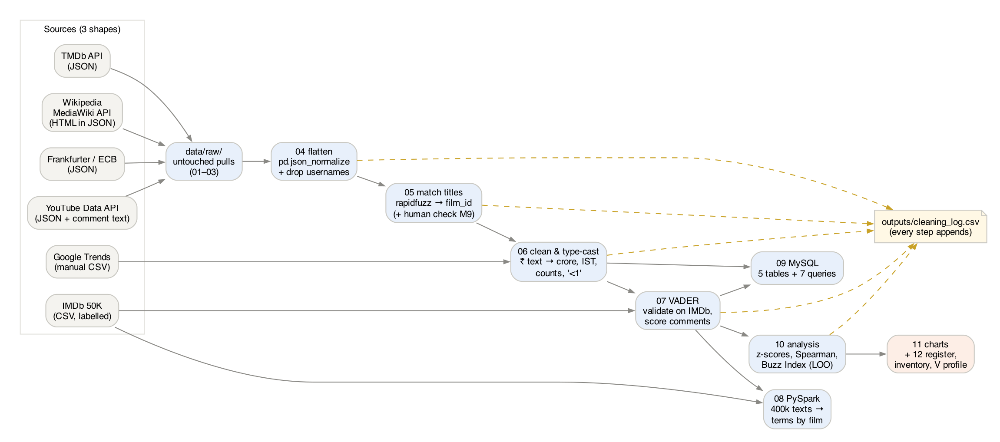
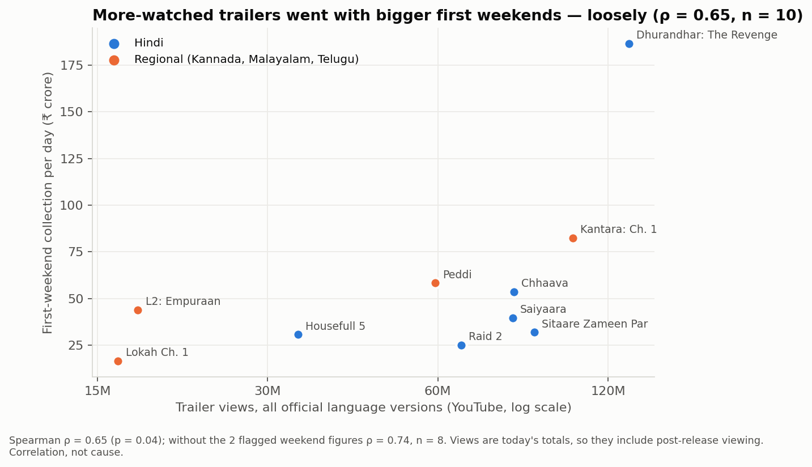
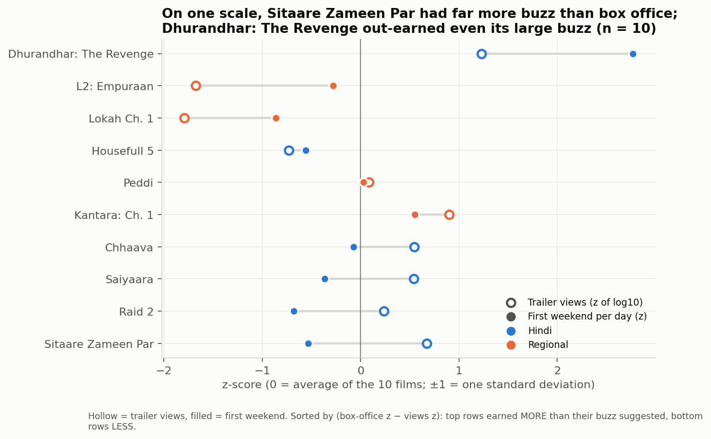
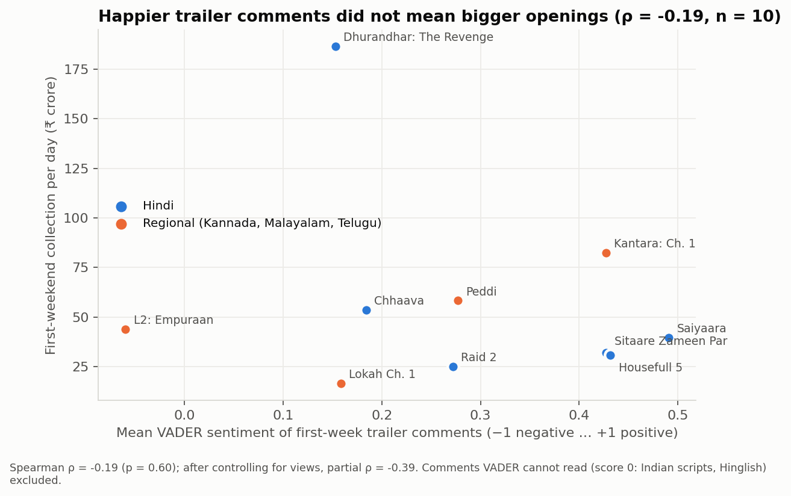
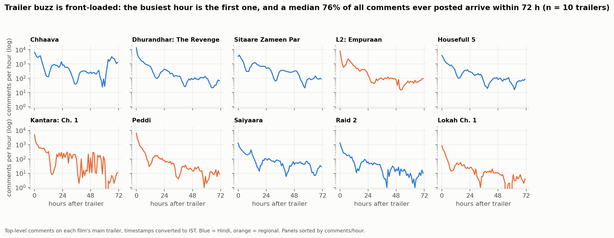
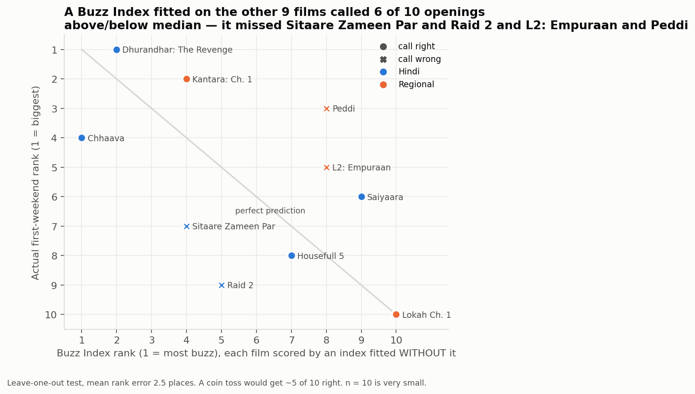

<!-- GENERATED FILE: edit report/report_template.md, then run `make report`. Every number below is filled in by src/14_build_report.py from files in outputs/. -->

# a. Executive summary

Across 10 Hindi and regional films released in 2025–26, films whose trailers were watched more had bigger first weekends, but the link is loose and does not prove that one causes the other. How *positive* the trailer comments sounded told us nothing extra: the biggest opener had some of the least positive comments, and a buzz score built from all our online signals called only {{num:loo_hits}} of 10 films correctly. For next Friday, use trailer reach as an early hint when planning shows, but make the add-or-cut screens decision on Friday's actual collections, not on online buzz.

::: glance
| Films studied | Trailer comments | Views vs weekend (ρ) | Sentiment vs weekend (ρ) | Buzz Index calls right |
|:---:|:---:|:---:|:---:|:---:|
| 10 | {{num:comments_clean}} | {{num:rho_views}} | {{num:rho_sent}} | {{num:loo_hits}} / 10 |
:::

# b. The question and why it matters

**Question.** *Did trailer-week YouTube engagement predict first-weekend collections for 10 Hindi and regional films released in 2025–26, and does audience sentiment add anything beyond raw views?*

**Decision it serves.** Within 72 hours of each Friday release, the Head of Distribution decides whether to **add screens, cut screens, or spend more on promotion**. Today that call rests on gut feel, a few trade tweets and the Friday-night number. Trailer buzz is available *weeks earlier*. If it predicted the first weekend, show bookings could be planned before release. If it does not, the desk should stop reading trailer hype as a signal.

**Films (n = 10, 4 regional):** Chhaava, Saiyaara, Sitaare Zameen Par, Housefull 5, Raid 2 and Dhurandhar: The Revenge (Hindi), plus Kantara: Chapter 1 (Kannada), Lokah Chapter 1: Chandra and L2: Empuraan (Malayalam) and Peddi (Telugu). They were chosen from 18 candidates because each has a stated first-weekend figure on Wikipedia and an official trailer with open comments. The eight dropped films, and the reason for each, are listed in `data/manual/film_list_proposed.csv`.

**Outcome measure.** First-weekend worldwide gross divided by the number of weekend days (₹ crore per day). Six films opened on a Thursday and had 4-day weekends, so raw totals would favour them.

# c. Data inventory and V profile

We used **6 sources in 3 shapes**:

- **Structured:** Wikipedia box-office infobox and text (MediaWiki API, HTML inside JSON) and Google Trends (CSV).
- **Semi-structured:** the YouTube Data API v3, TMDb and Frankfurter/ECB, all JSON.
- **Unstructured:** {{num:comments_clean}} YouTube trailer comments, plus the labelled IMDb 50K reviews as a practice corpus.

Every field is classified below.

{{table:data_inventory}}

## V profile (one page)

{{table:v_profile}}

**Which V dominated: Variety.** The same film arrived as "Saiyaara (film)", "Kantara - A Legend: Chapter 1" and "RAID 2 (TRAILER): Ajay D | Riteish D | …". Money arrived as "₹797.34–809 crore[b]", "est. ₹30−40 crore" and "over $80 million". Tying {{num:title_strings}} title strings to 10 film keys, and turning six kinds of money text into one number, took most of the build.

**Velocity came second, and it surprised us.** Trailer buzz is extremely front-loaded:

- For the median trailer, {{num:median_share72}} of all the comments it has *ever* received arrived in its first 72 hours.
- The busiest single hour carried {{num:peak_hour}} comments.
- Search interest peaks on release day and halves within about {{num:trends_half}} days.

**Volume was moderate.** We collected {{num:yt_mb}} MB of raw YouTube JSON ({{num:comment_pages}} API pages), and the Spark job processed {{num:spark_in}} texts.

**How the Vs changed our tools:**

- *Variety* pushed us to fuzzy matching (rapidfuzz), a shared `film_id`, and a relational model in MySQL.
- *Velocity* made us download **every** comment, not a 5,000-per-film cap. YouTube returns comments newest first, so a cap would have contained no trailer-week comments at all.
- *Volume*, once comments were split into {{num:spark_words}} word rows, is where PySpark earned its place.

# d. Pipeline: how data moves from source to chart

{width=100%}

| Stage | Script | What it does |
|---|---|---|
| Collect | `01`–`03` | MediaWiki API (`action=parse`), TMDb `/search` + `/movie`, YouTube `videos`/`search`/`commentThreads`. Raw JSON is saved untouched. YouTube quota is hard-capped at 10,000 units/day. |
| Flatten | `04` | `pd.json_normalize` turns nested JSON into tables. Author names, channel IDs and profile URLs are dropped here (example in Appendix C). |
| Match | `05` | Normalise titles, then score them with rapidfuzz: ≥ 95 accept, 70–94 a person confirms, < 70 reject. |
| Clean | `06` | ₹ text → crore, ranges → midpoint, USD → ₹ at the release-date ECB rate, UTC → IST, text counts → integers, Trends "<1" → 0.5. |
| Sentiment | `07` | VADER is validated on the labelled IMDb reviews, then scores every comment. |
| Big data | `08` | PySpark, local mode: clean, measure length, count terms, aggregate by film and source. |
| Model | `09` | MySQL: 5 tables with primary and foreign keys, and 7 queries (Appendix A). |
| Analyse | `10`–`12` | z-scores, Spearman ρ, a leave-one-out Buzz Index, a bot-burst check, charts, and the evidence tables. |

`make all` reruns everything from the raw data to the charts.

# e. Cleaning log

The pipeline logged **{{num:cleaning_n}} decisions**, each with the problem found, rows affected, action taken and why. Every script appends its own rows with the counts it measured. The full table is in **Appendix E** (moved there because of its length).

**The five decisions that mattered most:**

1. **Where the trailer clock starts.** Raid 2 had 16,245 comments posted up to 20.7 hours *before* the trailer's official publish time, because the video was viewable early. We start every trailer window at the earlier of the publish time and the first comment. This single fix moved the comments-vs-weekend correlation from 0.56 to {{num:rho_c7}}. We report the corrected, weaker number.
2. **Which number is "the first weekend".** Wikipedia gives opening figures as free text in mixed forms: day or weekend, worldwide or India-only, ranges, and USD. We saved all 38 candidate sentences and chose one phrase per film. The script then checks that the phrase appears **word for word** in the downloaded page, so a figure cannot be invented. Ranges became midpoints. Dhurandhar: The Revenge's "$80 million" was converted at the ECB rate on its release date.
3. **3-day vs 4-day weekends.** Six films opened on a Thursday. We divide by the number of days. Without that, those six would look about a third bigger.
4. **Film-name matching.** {{num:title_strings}} title strings were matched to 10 IDs. Two scores (79.1 and 90.9) were confirmed by a person. One was **rejected**: "Dhurandhar", the 2025 prequel. A looser scorer would have joined it to the sequel and imported the wrong ₹1,350-crore gross.
5. **Comments VADER cannot read.** {{num:share_indic}} of comments are written in Indian scripts and {{num:share_zero}} score exactly 0, mostly Hinglish, names or emojis. We kept them, because they count for velocity, and excluded zero scores from the sentiment averages.

**Missing values, decided one by one:**

- **Budgets.** Kantara has no budget published, and Dhurandhar: The Revenge's is "combined with part 1". Both are NULL; we kept the films and did not invent a split.
- **Two weekend figures are not clearly worldwide** (Housefull 5 and Sitaare Zameen Par). We kept and flagged them, and tested results without them.
- **Comments.** 4,161 empty comments were dropped. 5 duplicate IDs were dropped.
- **Trends.** No days were missing, so nothing was filled.

# f. Findings

{width=95%}

**Finding 1, combining two sources (YouTube and Wikipedia).** More-watched trailers went with bigger first weekends: Spearman ρ = {{num:rho_views}} (p = {{num:p_views}}, n = 10). Without the two flagged weekend figures it is ρ = {{num:rho_views_8}} (n = 8). *How sure are we?* Only moderately. Ten films is a tiny sample. View counts are **today's** totals, so a hit film's trailer keeps gaining views after release, which may inflate the link. And star power, screen count, holiday dates and franchise status all push views and collections up together.

{width=90%}

**Finding 2, normalised (z-scores).** Putting views and collections on one scale shows *where* buzz misled. Sitaare Zameen Par, Raid 2 and Saiyaara had much more trailer reach than first-weekend money. Dhurandhar: The Revenge and the two Malayalam films earned more than their trailer reach suggested. Sitaare's most common comment terms were "{{num:sitaare_terms}}": **a lot of its buzz was a boycott-and-copy argument, not intent to buy tickets**. That is one film, so treat it as a hypothesis.

{width=95%}

**Finding 3: sentiment adds nothing.** Mean comment sentiment did not track the first weekend: ρ = {{num:rho_sent}} (p = {{num:p_sent}}). After controlling for views it is, if anything, negative (partial ρ = {{num:partial_sent}}). On the labelled IMDb reviews VADER scored only {{num:vader_acc}} accuracy (macro-F1 {{num:vader_f1}}). It leans positive, calling {{num:vader_fp}} negative reviews positive, so its trailer scores are noisy too. Hindi trailers drew more positive comments than regional ones ({{num:sent_hindi}} vs {{num:sent_regional}}), partly because VADER reads English and Hinglish better than Indian scripts.

{width=100%}

**Finding 4: velocity.** For the median trailer, {{num:median_share72}} of all its comments ever arrived within 72 hours, and the busiest hour is the first. First-week comment counts were only weakly related to the first weekend (ρ = {{num:rho_c7}}, p = {{num:p_c7}}).

{width=80%}

**Finding 5: the Buzz Index (beyond the minimum).** We combined z-scored views, like ratio, comment volume, comment velocity and sentiment, weighting each by its rank correlation with the outcome. We then tested it honestly: each film was scored by an index built from the *other nine*. It called {{num:loo_hits}} of 10 openings correctly as above or below the median (mean rank error {{num:loo_err}} places), against about 5 of 10 for a coin toss. It missed {{num:loo_misses}}. **It is not reliable enough to act on alone.**

**Paid or bot buzz: Raid 2's early comments look seeded.** Raid 2 received {{num:raid_pre_n}} comments *before* its trailer's official publish time. **{{num:raid_pre_share}}** of them repeat text posted five or more times ("Can't wait", "So excited", "Trailer abhi tak nahi aaya? The wait is killing me!"). After publication, comments repeat at a rate of {{num:after_min}}–{{num:after_max}}, whatever the film. Raid 2 also has {{num:bot_raid}} of its longer comments in same-hour copy-paste bursts, against at most {{num:bot_others_max}} for every other film. We cannot prove who posted them, so we kept and flagged them. But they inflate Raid 2's comment-based buzz, and that fits the Buzz Index ranking it {{num:raid_pred_rank}}th when it actually opened {{num:raid_actual_rank}}th. Other films' bursts are mostly fan chants ("छत्रपति संभाजी महाराज की जय") and meme lines.

# g. Recommendation for next Friday

1. **Before release, sort, don't forecast.** Rank the new film's total trailer views (all language versions) against these 10 films:
   - **Top three:** pre-arrange *optional* extra shows with exhibitors.
   - **Bottom three:** do not add screens on hype.
   - Everything in between gives no signal.

   This is the strongest relationship we found (ρ = {{num:rho_views}}). It is still loose.
2. **Ignore whether the comments sound positive.** It added nothing (ρ = {{num:rho_sent}}). Instead, **check the buzz for two warning signs:**
   - controversy words in the top comment terms, such as "boycott" and "copy" (Sitaare Zameen Par)
   - large blocks of copy-paste comments, especially before the trailer is officially out (Raid 2)

   In both cases, discount the buzz.
3. **Make the actual add/cut call on Friday's collections**, with trailer reach only as a tie-breaker. Our best buzz score called {{num:loo_hits}} of 10, not enough to move screens on its own.
4. **Conditions.** This is evidence from 10 films and not causal, and it is weaker for regional releases (4 films). Re-check the rule after every new release by adding it to the sample. `make all` does this in one command.

# h. Limitations and bias

- **Sample size.** n = 10 (4 regional). One correction to one film changed a correlation from 0.56 to {{num:rho_c7}}. No result here is statistically robust.
- **Confounders.** Star power, screen count (not published consistently, so not used), holiday release, franchise status, budget and marketing spend, and Hindi vs regional market size.
- **Views are today's counts.** Trailer-week view counts cannot be fetched after the fact, so views include post-release viewing. That is a reverse-causation risk.
- **Who writes YouTube comments.** They come from younger, online, English/Hinglish-heavy fans, not ticket buyers in general. Regional audiences may comment on other platforms.
- **Paid promotion and bots.** We found one likely case: Raid 2's pre-publish comments are {{num:raid_pre_share}} copy-paste. We kept them, so its comment counts are probably inflated. Our checks cannot see paid *views*, or coordinated accounts that vary their wording.
- **Regional vs Hindi coverage.** Only 4 regional films, no Tamil film (Coolie had no weekend figure), and Sitaare's Tamil and Telugu trailers came out weeks later, outside our 3-day version window.
- **Box-office reliability.** Wikipedia figures mix producer-reported and trade estimates. They come as ranges and "est." values, with one in USD and one India-only. We used midpoints and flagged exceptions.
- **VADER's limits.** {{num:vader_acc}} accuracy on IMDb. It cannot read Indian scripts ({{num:share_indic}} of comments), and it misses Hinglish, sarcasm and many emojis. {{num:share_zero}} of comments score 0.
- **Missing Reddit data.** API access needs approval, so Reddit was skipped. Discussion-forum audiences may differ again.

# i. Reflection

**How the question changed.** We began with "do trailer views predict opening weekends?" Three things changed it:

1. Wikipedia rarely states an "opening weekend" in a consistent form, which forced the per-day measure and the flagged exceptions.
2. We learned that YouTube only returns *today's* view counts. So "trailer-week engagement" had to be measured from comment **timestamps**, and views became a weaker, after-the-fact proxy.
3. Correcting Raid 2's trailer start time cut the comments correlation, and cut the Buzz Index from 8 to {{num:loo_hits}} correct calls. Looking into *why* Raid 2 had so many early comments then revealed the copy-paste pattern. The honest answer became "views are a loose hint, sentiment is noise, and comment counts can be gamed."

**With better data we would:**

- capture view counts *daily* from trailer launch (live tracking during release week)
- use screen counts and day-wise collections from a trade source with a licence
- use a multilingual sentiment model for Hindi, Telugu, Tamil, Kannada and Malayalam
- add Reddit and X once API access is approved
- extend the sample to 30+ releases, so the rule of thumb can be tested on films it has never seen

[[TODO-HUMAN: add one or two sentences, in your own words, on what surprised the team most]]

\newpage

# Appendix A — ER diagram, schema and SQL queries with outputs

{width=75%}

Rows loaded into MySQL:

{{table:mysql_counts}}

Schema (`sql/schema.sql`):

```sql
{{file:sql/schema.sql}}
```

{{file:outputs/tables/sql_query_results.md}}

# Appendix B — PySpark row counts

Local-mode job over trailer comments plus IMDb 50K, tagged by `source` (`src/08_spark_text_job.py`, `notebooks/spark_text_job.ipynb`):

{{table:spark_counts}}

Top terms per film:

{{table:top_terms}}

# Appendix C — json_normalize before and after

{{file:outputs/tables/json_normalize_example.md}}

# Appendix D — Spreadsheet vs pandas (₹ text → crore)

The same cleaning step was done twice, on the same 36 real money strings taken from our Wikipedia data: once in Google Sheets with formulas (manual step M10) and once in pandas (`parse_money_to_crore` in `src/06_clean_typecast.py`). The two agreed on **{{num:sheet_agree}}** strings.

{width=90%}

{width=90%}

| | Google Sheets | pandas |
|---|---|---|
| Time taken | [[TODO-HUMAN: minutes from M10]] | about 20 minutes to write and test the function once; under 1 second per rerun |
| Reproducibility | Formulas are visible, but a re-import or a sorted column can silently break the cell references | Same code, same output, every `make all` |
| Error risk | Copy-paste ranges and locale settings (decimal comma) can go wrong unnoticed | The function is tested on all 36 strings and checked against the Sheets result |
| Scale | Fine for 36 strings; impractical for 350k comments | The same approach scales to millions of rows |
| Best for | Quick one-off look and teaching the logic | The pipeline |

{{table:sheet_compare}}

# Appendix E — Full cleaning log

{{table:cleaning_log}}

# Appendix F — Source register

{{table:source_register}}

# Appendix G — Sentiment validation and blind spots

{{table:vader}}

{{table:blind}}

# Appendix H — All correlations, the leave-one-out test and the pre-publish check

{{table:correlations}}

{{table:loo}}

Comments before and after each trailer's official publish time, and the share that repeat text posted 5+ times:

{{table:prepublish}}

# Appendix I — AI-use disclosure

See `report/appendix_ai_use.md` (included in the submission).
