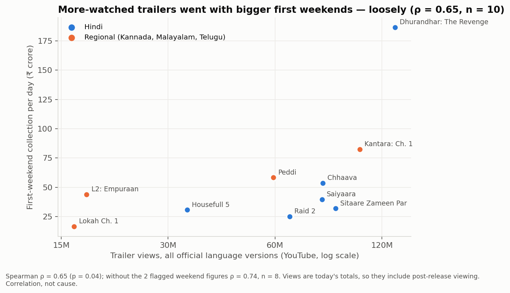
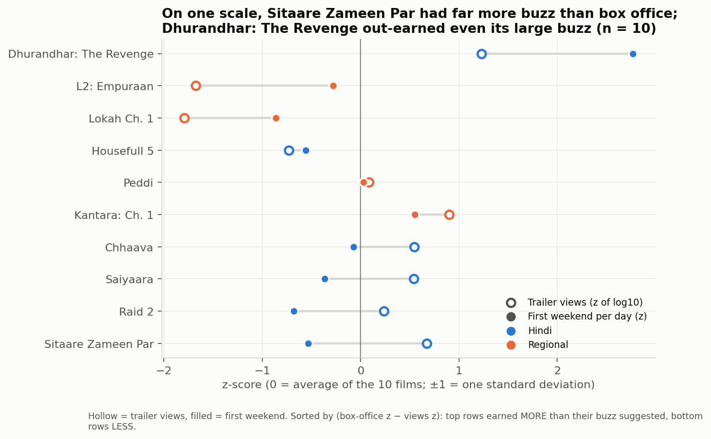
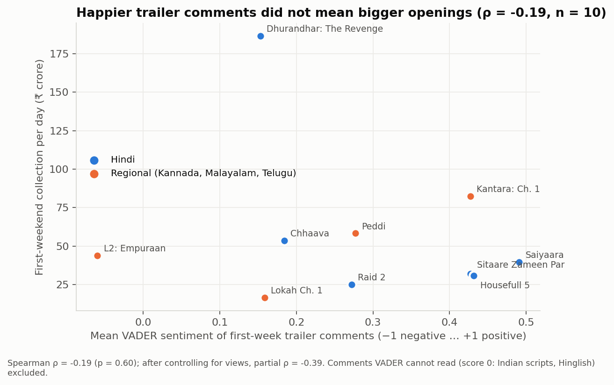

<!-- GENERATED FILE: edit report/slides_template.md, then `make report` → slides.pptx. 10 slides, 7 minutes. -->

# Answer: plan on Friday's numbers; use trailer reach only as a hint

- Bigger trailer reach went with bigger first weekends, **loosely** (ρ = 0.65, 10 films)
- Whether comments sounded **positive added nothing** (ρ = -0.19)
- Our best buzz score called **6 of 10** openings, not enough to move screens on its own

*Release Day Radar · Case Study A · [[TODO-HUMAN: team name]]*

::: notes
[0:00–0:40] Open with the answer. "If you remember one thing: trailer reach is a loose hint, trailer mood is noise, and the screens decision should still be made on Friday's collections." Say the three numbers slowly.
:::

# The decision: add, cut or promote, within 72 hours of Friday

- Today the call rests on gut feel, trade tweets and the Friday-night number
- Trailer buzz exists **weeks earlier**. Could it plan shows in advance?
- Our question: *did trailer-week YouTube engagement predict first-weekend collections for 10 films (2025–26), and does sentiment add anything?*

::: notes
[0:40–1:20] Name the reader (Head of Distribution) and the decision. Ten films: six Hindi, four regional (Kannada, Malayalam ×2, Telugu).
:::

# Variety dominated: six sources, three shapes, one film key

- Wikipedia (HTML in JSON), YouTube and TMDb (JSON), Google Trends (CSV), ECB rates (JSON), IMDb 50K (CSV)
- **350,426** trailer comments; Spark processed **400,008** texts
- Velocity: a median **78%** of a trailer's comments arrive in its first 72 hours

::: notes
[1:20–2:00] Variety was the hard part. Velocity explains why we downloaded every comment: YouTube returns newest first, so a 5,000 cap would have missed trailer week entirely.
:::

# The join problem: 56 spellings → 10 film IDs

- "Kantara - A Legend: Chapter 1", "RAID 2 (TRAILER): Ajay D | …", "Saiyaara (film)"
- Normalise, then fuzzy-score: ≥ 95 accept · 70–94 a person checks · < 70 reject
- Correctly **rejected** "Dhurandhar" (2025) as a match for *Dhurandhar: The Revenge*

::: notes
[2:00–2:40] Explain why token_sort_ratio and not partial_ratio for full titles: extra words must lower the score, otherwise the prequel's ₹1,350 crore would be joined to the sequel.
:::

# Cleaning decisions that changed the answer

- Raid 2's trailer had comments **20.7 hours before** its official publish time. The fix cut our comment signal from 0.56 to **0.37**
- First weekends: ranges → midpoint, $80M → ₹ at the ECB rate, ÷ 3 or 4 days
- 32 logged decisions, all with real row counts

::: notes
[2:40–3:30] This is the honesty slide. One timestamp fix weakened our own result, and we kept the corrected number. Mention the word-for-word check that stops any box-office figure being invented.
:::

# More-watched trailers went with bigger weekends, loosely

::: notes
[3:30–4:15] ρ = 0.65, n = 10; 0.74 without the two flagged figures. Caveat: view counts are today's totals and include post-release viewing. Not causal: star power, screens and holidays push both up.
:::

# On one scale, some films' buzz over-promised

::: notes
[4:15–5:00] This chart combines two sources on z-scores. Sitaare Zameen Par had high reach but a small weekend; its top comment words were "boycott" and "copy". Dhurandhar 2 and the Malayalam films out-earned their buzz.
:::

# Comment mood didn't matter, and a buzz score barely beat a coin

::: notes
[5:00–5:45] Sentiment ρ = -0.19; VADER itself is only 0.700 accurate on IMDb and can't read Indian scripts. Buzz Index, leave-one-out: 6/10 versus about 5 for a coin toss. Raid 2's pre-publish comments were 88.6% copy-paste, so comment counts can be gamed.
:::

# Next Friday: sort by reach, scan for controversy, decide on Friday

- **Top three** reach vs these 10 films → line up *optional* extra shows · **bottom three** → no extra screens on hype
- Ignore positivity; discount buzz with **"boycott"/"copy"** terms or **copy-paste comment blocks**
- Make the add/cut call on **Friday collections**; re-check the rule after every release

::: notes
[5:45–6:30] Give the rule of thumb and its uncertainty: 10 films, not causal, weaker for regional releases.
:::

# Limits and what's next

- Only 10 films (4 regional, no Tamil); today's views, not trailer-week views
- YouTube commenters ≠ ticket buyers; VADER misses Hinglish and Indian scripts
- Next: daily view capture from trailer launch, a licensed trade source with screens, multilingual sentiment, 30+ films

::: notes
[6:30–7:00] Close: "The data can defend a loose hint, not a forecast." Invite questions.
:::
